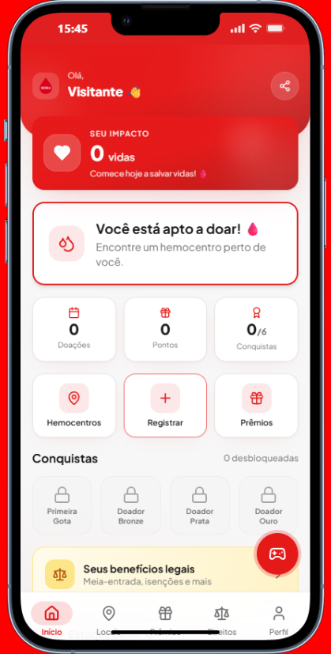
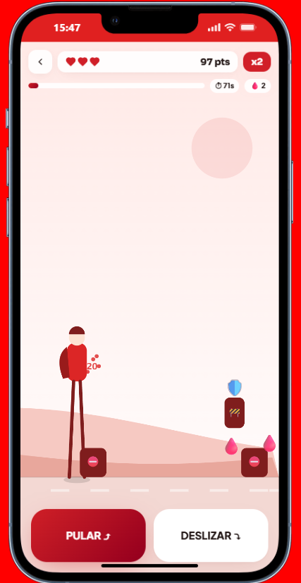

# 🩸 Doe+ RS

**Um app para transformar quem "pensa em doar sangue um dia" em quem doa de verdade.**
Facilitando o acesso à doação de sangue no Rio Grande do Sul.

---

## O problema

O Brasil vive uma escassez crônica de sangue.

- Segundo o **Ministério da Saúde**, apenas cerca de **1,6% da população brasileira** doa sangue — abaixo do intervalo de **1% a 3%** que a **Organização Mundial da Saúde** considera necessário para abastecer um país.
- Os estoques **despencam no inverno e em feriados prolongados**, justamente quando acidentes e cirurgias não diminuem.
- No **Rio Grande do Sul**, as enchentes de **maio de 2024** reduziram drasticamente os estoques e forçaram um apelo nacional por doações — a prova de que o sistema opera sempre no limite.
- Uma única doação (~450 ml) pode **beneficiar até 4 pessoas**, já que o sangue é separado em componentes (hemácias, plasma, plaquetas). Mesmo assim, sobra medo e falta informação.

E o gargalo raramente é falta de vontade. É **acesso e fricção**:

| Barreira | O que acontece na prática |
| --- | --- |
| "Será que eu posso doar?" | Tatuagem recente, idade, remédio, peso… a pessoa desiste na dúvida. |
| "Onde eu doo?" | Não sabe qual hemocentro é o mais perto nem o horário. |
| "Quando posso doar de novo?" | Esquece o intervalo entre doações e perde a janela. |
| "Depois eu vou" | Sem lembrete e sem hábito, o "depois" nunca chega. |

---

## A ideia

**Doe+ RS** nasceu para **derrubar essas barreiras uma a uma** e tornar a doação de sangue uma coisa simples, próxima e recorrente — não um evento raro movido a campanha de emergência.

| Barreira | Como o app resolve |
| --- | --- |
| **Elegibilidade** | Quiz de elegibilidade responde "posso doar?" em cerca de 1 minuto. |
| **Localização** | Mapa de hemocentros do RS com busca por cidade e nome. |
| **Recorrência** | Registro de doações com cálculo automático da próxima data (60 dias para homens, 90 para mulheres, conforme o Ministério da Saúde). |
| **Hábito** | Pontos, conquistas, cartão digital e o jogo **DOE+ Hero** mantêm o engajamento vivo entre uma doação e outra. |

---

## O que tem dentro

- **Onboarding + cadastro do doador** (tipo sanguíneo, cidade, histórico).
- **Quiz de elegibilidade** guiado.
- **Dashboard** com status de doação, contador de impacto ("vidas salvas") e próxima data.
- **Hemocentros** — lista pesquisável de pontos de coleta do Rio Grande do Sul.
- **Recompensas e benefícios** — pontos por doação, catálogo de recompensas e parceiros.
- **Conquistas / badges** e **cartão digital de doador** compartilhável.
- **DOE+ Hero** — jogo de conscientização integrado (abaixo).
- **Modo convidado** para explorar sem criar conta.
- Empacotável como **app Android / iOS** via Capacitor.

---

## 🎮 DOE+ Hero

Um jogo *runner* de conscientização embutido no próprio app, em **`/jogo`** (botão flutuante no Dashboard).

O jogador é um "Herói da Doação" que corre por cenários do RS coletando bolsas de sangue e respondendo **quizzes com informação real** sobre doação — enquanto sobe de nível, cumpre missões diárias e disputa o ranking. Mesmo login, mesmo deploy, mesma identidade visual (escopada em `.doe-hero-game`, sem interferir no resto do app).

| Rota | Tela |
| --- | --- |
| `/jogo` | Início do herói |
| `/jogo/mapa` | Fases |
| `/jogo/missoes` | Missões diárias |
| `/jogo/ranking` | Ranking |
| `/jogo/conquistas` | Conquistas |
| `/jogo/perfil` | Perfil do jogador |
| `/jogo/jogar/:fase` | Corrida pela Vida (gameplay) |

---

## Telas

<div align="center">
<table>
  <tr>
    <td align="center">
      <br/>
      <sub><b>Dashboard</b> — status de doação, impacto e atalhos</sub>
    </td>
    <td align="center">
      <br/>
      <sub><b>DOE+ Hero</b> — a Corrida pela Vida</sub>
    </td>
  </tr>
</table>
</div>

> Mais capturas podem ser adicionadas em `docs/screenshots/` seguindo o mesmo padrão.

---

## Stack

| Camada | Tecnologia |
| --- | --- |
| Front-end | Vite + React 18 + TypeScript |
| UI | Tailwind CSS + shadcn/ui + Framer Motion |
| Dados / auth | Supabase (Postgres + Auth + Storage) |
| Estado de servidor | TanStack Query |
| Mobile | Capacitor 8 (Android / iOS) |
| Testes | Vitest + Testing Library |
| CI | GitHub Actions — lint · typecheck · testes · build |
| Deploy | Vercel (front-end) + Supabase (back-end) |

---

## Rodando localmente

Requisitos: **Node 20+**.

```bash
npm install
cp .env.example .env      # preencha com as credenciais do Supabase
npm run dev               # http://localhost:8080
```

**Variáveis de ambiente**

| Variável | Descrição |
| --- | --- |
| `VITE_SUPABASE_URL` | URL do projeto Supabase |
| `VITE_SUPABASE_PUBLISHABLE_KEY` | Chave publishable / anon |

O `.env` é ignorado pelo git. Em produção, defina as variáveis no painel da Vercel. Sem elas, `src/integrations/supabase/client.ts` usa valores de fallback.

---

## Scripts

| Comando | Ação |
| --- | --- |
| `npm run dev` | Servidor de desenvolvimento |
| `npm run build` | Build de produção em `dist/` |
| `npm run preview` | Serve o build localmente |
| `npm test` | Testes (Vitest) |
| `npm run typecheck` | Checagem de tipos (`tsc --noEmit`) |
| `npm run lint` | ESLint |

---

## Estrutura

```
src/
├── pages/            Telas do app (Onboarding, Dashboard, Hemocentros, Perfil…)
├── routes/           AppRoutes — rotas do app + do jogo, atrás de ProtectedRoute
├── components/       Componentes compartilhados + ui/ (shadcn)
├── data/             Dados estáticos (hemocentros, recompensas, cidades do RS…)
├── hooks/            useAuth, useGeolocation…
├── lib/              Utilidades (format, geo, native/Capacitor, guest…)
├── integrations/
│   └── supabase/     client.ts + tipos gerados
└── game/             DOE+ Hero — engine, telas, tema escopado
supabase/migrations/  Esquema do banco (aplicar com o Supabase CLI)
docs/screenshots/     Capturas de tela usadas neste README
```

---

## Deploy

**Vercel**

- Build Command: `npm run build`
- Output Directory: `dist`
- Environment Variables: `VITE_SUPABASE_URL`, `VITE_SUPABASE_PUBLISHABLE_KEY`

**Banco (Supabase)**

```bash
supabase db push        # aplica as migrations de supabase/migrations/
```

---

## Status

**Projeto funcional e pronto para demonstração.** O fluxo principal do doador está implementado e o DOE+ Hero está integrado ao app. Os itens abaixo são evoluções planejadas — **não são dependências para o funcionamento atual**:

- Notificações de "você já pode doar de novo".
- Hemocentros com geolocalização real + rota.
- Ranking do jogo com dados reais (hoje é mock).
- Monitoramento de erros em produção (Sentry).

---

<div align="center">

As estatísticas citadas são atribuídas ao **Ministério da Saúde** e à **Organização Mundial da Saúde** — confira os números mais recentes nas fontes oficiais antes de usá-los em comunicação pública.

**Feito para incentivar a doação de sangue no Rio Grande do Sul.** 🩸

</div>
